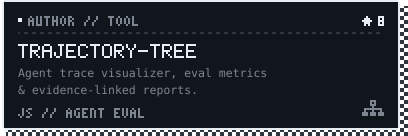
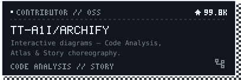

<div align="center">
  <picture>
    <source media="(prefers-color-scheme: dark)" srcset="./assets/hero-dark.svg" />
    <source media="(prefers-color-scheme: light)" srcset="./assets/hero-light.svg" />
    
  </picture>
</div>

<br />

> Building agent tools, trace visualizers, and quiet minimal interfaces — somewhere above the clouds.

```text
NOW      ▸ Working on trajectory-tree & contributing Code Analysis + Story choreography to archify.
FOCUS    ▸ Agent Tooling · Trace Visualization · Interactive Diagrams · Minimalist UI
```

<p align="center">
  <a href="https://github.com/goatliamia/trajectory-tree">
    <picture>
      <source media="(prefers-color-scheme: dark)" srcset="./assets/card-trajectory-dark.svg" />
      <source media="(prefers-color-scheme: light)" srcset="./assets/card-trajectory-light.svg" />
      
    </picture>
  </a>
  &nbsp;
  <a href="https://github.com/tt-a1i/archify">
    <picture>
      <source media="(prefers-color-scheme: dark)" srcset="./assets/card-archify-dark.svg" />
      <source media="(prefers-color-scheme: light)" srcset="./assets/card-archify-light.svg" />
      
    </picture>
  </a>
</p>

<br />

<div align="center">
  <picture>
    <source media="(prefers-color-scheme: dark)" srcset="./assets/skyline-dark.svg" />
    <source media="(prefers-color-scheme: light)" srcset="./assets/skyline-light.svg" />
    
  </picture>
</div>

<br />

<p align="center">
  <sub>1-bit cloud ecosystem · auto-refreshes every 4h via GitHub Actions</sub>
</p>
