<div align="center">
  <picture>
    <source media="(prefers-color-scheme: dark)" srcset="./assets/hero-dark.svg" />
    <source media="(prefers-color-scheme: light)" srcset="./assets/hero-light.svg" />
    
  </picture>
</div>

<br />

> Building agent tools, trace visualizers, and quiet minimal interfaces — somewhere above the clouds.

```text
NOW      ▸ Working on trajectory-tree — agent traces, eval metrics & evidence-linked reports.
FOCUS    ▸ Agent Tooling · Trace Visualization · Minimalist UI
```

### Featured

| Project | Stack | Note |
| :--- | :--- | :--- |
| [**`trajectory-tree`**](https://github.com/goatliamia/trajectory-tree) | `JS / AGENT EVAL` | Visualize agent traces, explore Eval metrics and evidence-linked reports for DSH, Pi, Codex and Claude Code, plus an Antigravity context sidebar. |

<br />

<div align="center">
  <picture>
    <source media="(prefers-color-scheme: dark)" srcset="./assets/skyline-dark.svg" />
    <source media="(prefers-color-scheme: light)" srcset="./assets/skyline-light.svg" />
    
  </picture>
</div>

<br />

<p align="center">
  <sub>1-bit cloud ecosystem · auto-refreshes every 4h via GitHub Actions</sub>
</p>
